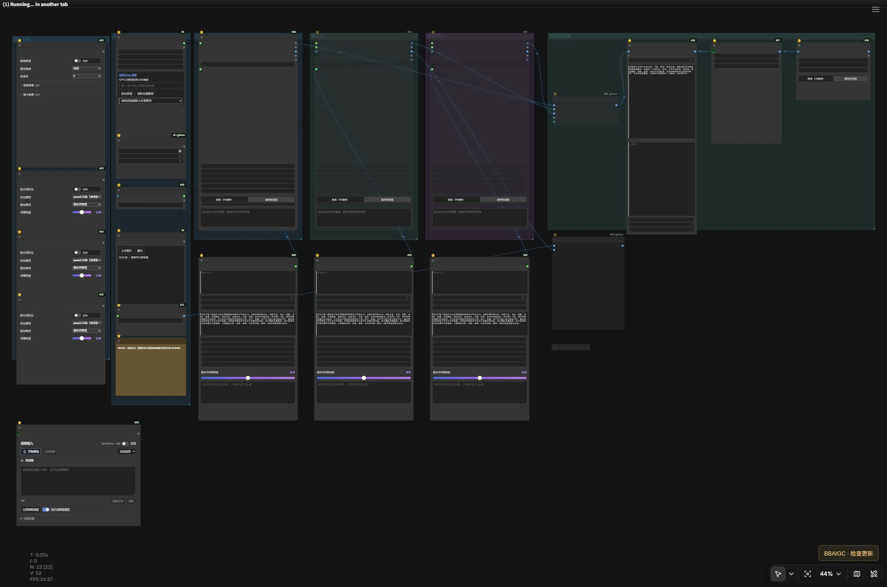

<div align="center">

# BBAIGC BBAPI 生图工作台

### 文生图 · 图生图 · 多图参考 · 批量并发


[快速安装](#智能体开箱即用--复制即装) · [模型与依赖](MODELS.md) · [安装提示词](AGENT_INSTALL.md) · [版本清单](release.json)

</div>

**把云端图片生成接入 ComfyUI：集中管理连接、参考图、批量请求与结果。** 基础生图无需下载本地图像模型，也不要求 NVIDIA 显卡；需要本地提示词优化、修复或超分时，再添加对应模型。



> 当前截图只展示工作流布局，不包含私人图片或生成案例。

## 核心功能

| 功能 | 使用方式 |
|---|---|
| 文生图 | 输入描述，选择接口开放的图像模型与质量/尺寸 |
| 单图编辑 | 上传或连接原生 IMAGE，配合编辑说明生成 |
| 多图参考 | 共用上传区管理参考顺序，支持外接 1～16 张图片；具体模型可能限制更少 |
| 批量生成 | 批量与并发均有上限，按请求序号整理结果与失败报告 |
| 自动模型选择 | 按接口返回的可用模型配置选择，实际目录以自己的密钥权限为准 |
| 可选本地增强 | Ollama 提示词优化、图像修复与超分按需开启 |
| 安全保存 | 密钥通过本机配置保存，不作为工作流或图片元数据中的节点输入 |

上传参考图、外接 IMAGE 与文件夹批处理可用于不同任务；文件夹处理默认关闭，避免误处理整个目录。只开启需要的生成组，参数与结果保持对应。

## 适用场景

| 你希望完成的事 | 建议方式 |
|---|---|
| 不安装大模型，直接调用图像服务 | 基础 API 生图 |
| 把 ComfyUI 上游图片交给云端编辑 | 原生 IMAGE 连接到单图/多图入口 |
| 同一要求生成多个候选 | 设置批量和适当并发，保留请求编号 |
| 统一处理已有图片 | 先确认输入目录，再启用文件夹批处理 |
| 云端出图后本地增强 | 按需启用本地修复与超分 |

服务支持的模型、参考图数量、尺寸、质量和费用以实际接口为准。模型返回列表不代表所有模型都具备相同编辑能力。网络超时不会自动补发付费请求；先查服务端记录，再决定是否重试。

## 智能体开箱即用 · 复制即装

支持 **Codex、Claude Code、Cursor、Windsurf、Trae、通义灵码、CodeBuddy** 等具备本地工具权限的智能体。点击代码块右上角复制按钮，粘贴后即可交给智能体完成环境识别、依赖安装、模型下载与部署检查。

<details>
<summary><strong>智能体开箱即用 · 复制即装</strong></summary>

```text
请在我的电脑上安装 BBAIGC「BBAPI 生图工作台」。
仓库：https://github.com/BBAIGC/ComfyUI-BBAIGC-BBAPI

先读取仓库的 README.md、MODELS.md、AGENT_INSTALL.md 和 release.json，再按照 AGENT_INSTALL.md 的完整步骤直接完成部署。自动找到我实际使用的 ComfyUI、Python 环境、模型与用户目录，保留现有模型、提示词、密钥和输出。复用已安装的共享节点，避免重复注册；按 MODELS.md 的来源、精确文件名、大小和位置下载真正需要的模型。不要盲目重装或降级已可工作的 PyTorch，不要把私有密钥写入工作流或上传仓库。
如果尚未指定模型方案，请在识别硬件后一次性让我选择：A作者同款（图片UC Q6_K与作者配套编码器/VAE，H3采用有公开来源的基础INT8+官方8步LoRA）；B按本机显存/内存适配的同架构量化；C高配更高精度；D作者同款再加一个适配版本。说明各方案的真实下载体积、兼容性和取舍后再下载；我已明确指定时直接按指定方案，禁止默认全部下载。
完成依赖、工作流部署和无付费、无推理的加载检查，告诉我实际安装位置、版本、可用入口与缺失项。需要登录、验证码或接受模型许可时再让我操作；其他可自动完成的部分直接继续。
```

[完整安装提示词与细节 →](AGENT_INSTALL.md)

</details>

也可手动安装：先阅读 [模型与节点清单](MODELS.md)，将节点仓库安装到当前 ComfyUI 的 `custom_nodes`，在对应 Python 环境安装 `requirements.txt`，把公开工作流导入 `user/default/workflows/BBAIGC`，随后重启并检查是否缺失节点。图片工作流仓库是工作流包，实际共享运行节点来自 H3 仓库。

## 连接与密钥

在连接节点输入自己的服务地址，在密码框填写 API Key 并保存，再读取可用图像模型。示例服务：[BBAPI](https://bbapi.ainivox.cn)。读取 `/v1/models` 只用于查询目录，正式生成按用户接口服务的计费规则执行。

Windows 下的本机配置使用当前用户 DPAPI 加密，换电脑或换 Windows 用户后需重新填写。公开工作流不含密钥；不要把本机配置文件、账号资料或请求日志上传到仓库。其他系统的安全存储支持须以当前节点实现为准。

## 依赖与硬件

- BBAPI 节点包：本仓库。
- 共用提示词、图像处理与输出节点：[BBAIGC MiniMax H3 共享节点](https://github.com/BBAIGC/ComfyUI-BBAIGC-MiniMax-H3)，安装节点包即可，**基础 API 生图不需要下载 H3 视频模型**。
- 分组开关与图像对比：[rgthree/rgthree-comfy](https://github.com/rgthree/rgthree-comfy)。
- 可选模型与超分插件：[MODELS.md](MODELS.md)。

作者的本地增强环境是 **RTX 5060 Ti 16GB · i7-12700KF · 64GB 内存**。云端生图耗时由上游模型与排队状态决定，不以本地 GPU 规格作速度承诺。

## 命令安装

推荐先使用上面的智能体安装提示词。以下 PowerShell 示例需将三个路径改成当前实例的真实位置：`ComfyCore` 含 `folder_paths.py`，`ComfyBase` 含实例的 `custom_nodes/models/user`，`ComfyPython` 是运行它的 Python。Desktop、便携版与手工安装不能混用环境。

```powershell
$ComfyCore = 'C:\ComfyUI\ComfyUI'
$ComfyBase = 'C:\ComfyUI'
$ComfyPython = 'C:\ComfyUI\.venv\Scripts\python.exe'
git clone https://github.com/BBAIGC/ComfyUI-BBAIGC-BBAPI
& $ComfyPython ".\ComfyUI-BBAIGC-BBAPI\install.py" --comfy-root $ComfyCore --base-dir $ComfyBase --download-models none --with-speech
```

安装器保留已有用户工作流与密钥，复用同一来源的节点，先检查已有 PyTorch 栈再安装依赖。首次没有选定量化时先读 [模型档位](MODELS.md)，不要直接下载所有模型。将 `--download-models` 改为 `none` 可只装节点与工作流；`speech`、`qwen-turbo`、`krea`、`h3` 是相应模型组合，`--with-speech` 额外补齐语音四文件。下载组合只决定文件下载，不会擅自改动现有工作流的模型选择；打开后按所选模型切换路线并检查文件名。

## 更新

版本、更新入口与发布下载见 [release.json](release.json)。更新前保留自己的工作流 JSON；节点代码与公开工作流更新不应覆盖本机密钥配置。

## 联系与支持

有问题可通过 [Issues](https://github.com/BBAIGC/ComfyUI-BBAIGC-BBAPI/issues) 反馈，附工作流版本、模型名称和脱敏后的错误信息。

<table>
<tr><th>联系作者</th><th>微信支持</th><th>支付宝支持</th></tr>
<tr>
<td align="center"></td>
<td align="center"></td>
<td align="center"></td>
</tr>
</table>

模型、依赖插件与本项目各自遵循其许可证。BBAIGC 提供工作台与流程整合，上游模型及节点作者保留各自署名。
